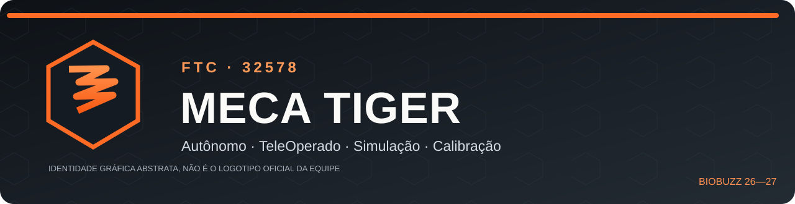

# Meca Tiger FTC #32578 — Programação do Mequinha

**SESI SENAI Maracanaú · Ceará, Brasil · Temporada BIOBUZZ 2026–2027**

Repositório técnico de engenharia de software do nosso robô: **autônomo com e sem câmera, TeleOp, diagnóstico, modelos de simulação, relatórios de validação e procedimentos de calibração**.

O projeto tem duas metas: permitir que a equipe continue programando com segurança e tornar o conhecimento compreensível para outras equipes de robótica. Os arquivos históricos são preservados; código novo não substitui as versões anteriores silenciosamente.

## Comece aqui

| Quero... | Acesse |
|---|---|
| Entender o projeto e a estrutura | **[Portal da documentação](docs/README.md)** |
| Aprender todo o desenvolvimento do autônomo | [Dossiê técnico das versões 2–5.1](DOSSIER_TECNICO_COMPLETO_AUTONOMO.md) |
| Consultar/calibrar o autônomo | [Manual geral de calibração](MANUAL_GERAL_CALIBRACAO_TESTES.md) |
| Ver os **12 códigos originais** do autônomo | [Índice de fontes e históricos](INDICE_COMPLETO_CODIGOS_AUTONOMO.md) |
| Pilotar, entender os botões e os mecanismos | **[Manual do TeleOp com desenho dos gamepads](teleop/MANUAL_COMPLETO.md)** |
| Ver a validade de cada teste | [Relatório geral de validação](RELATORIO_GERAL_VALIDACAO_SOFTWARE.md) |
| Registrar testes feitos no robô | [Ficha de ensaios](MODELO_REGISTRO_ENSAIO_AUTONOMO.md) |
| Contribuir ou revisar alterações | [Guia de contribuição](CONTRIBUTING.md) |
| Preparar futura publicação pública | [Checklist de publicação](docs/PUBLICACAO.md) |

## Software disponível

| Subsistema | Versões e classe candidata | Estado verificável |
|---|---|---|
| Autônomo **sem câmera** | 3.1–3.5; candidata `Autonomo35.java` | Compilação FTC confirmada; calibração física pendente |
| Autônomo **com câmera** | 4.0–4.2, 5.0–5.1; candidata `Autonomo51.java` | Compilação FTC confirmada; C270 e mira física pendentes |
| TeleOp **manual** | 1.0–1.1; classe `TeleOp11.java` | Compilação FTC confirmada; sinais físicos pendentes |
| TeleOp **IMU + mecanismos** | 1.2–1.3; `TeleOp12.java`/`TeleOp13.java` | **Experimental**: depende de CI e ensaios físicos |

**O que “compilado” significa:** as classes Java foram aceitas pelo projeto FTC SDK utilizado no GitHub Actions. **Não equivale a testes em pista ou prova de pontuação.** Veja a [matriz de evidências](docs/TESTES.md). O projeto preserva as simulações e os testes matemáticos, sem apresentá-los como medições reais.

## Estrutura do repositório

```text
.
├── TeamCode/src/main/java/org/firstinspires/ftc/teamcode/
│   ├── Autonomo/             # Versões Java do autônomo + diagnósticos
│   └── teleOp/               # TeleOp 1.0, 1.1, 1.2 e 1.3
├── assets/                   # Banner e diagramas SVG
├── docs/                     # Portal, arquitetura, testes e publicação
├── teleop/                   # Manual ilustrado e estudo do IMU
├── historico/                # Snapshots e validações individuais do autônomo
├── historico_teleop/         # Snapshots e validações individuais do TeleOp
├── tests/                    # Simulações e testes matemáticos em Node.js
├── .github/workflows/        # Compilação e verificações automatizadas
├── README.md                 # Você está aqui
├── CHANGELOG.md              # Mudanças registradas por versão
└── AGENTS.md                 # Convenções de trabalho no repositório
```

Não movemos os históricos antigos para preservar **links, hashes de conteúdo, rastreabilidade e referências cruzadas**. O [portal de documentação](docs/README.md) é a navegação única; cada documento original continua no lugar.

## Como compilar no Android Studio

Este repositório armazena **o código da equipe**, mas **não** uma cópia completa do projeto Android FTC. Use o workspace oficial **FTC SDK 12.0**, correspondente à temporada:

1. Obtenha o [FTC Robot Controller v12.0](https://github.com/FIRST-Tech-Challenge/FtcRobotController/releases/tag/v12.0) e abra o projeto completo no Android Studio compatível (Narwhal 3 Feature Drop ou posterior).
2. Copie as classes Java desejadas de `TeamCode/src/main/java/org/firstinspires/ftc/teamcode/Autonomo/` e/ou `.../teleOp/` deste repositório para o mesmo pacote dentro do `TeamCode` do projeto FTC. Mantenha os nomes de classes e arquivos.
3. Configure os nomes do hardware no Driver Station: `MD`, `ME`, `MI`, `MS`, `imu`; e `Webcam 1` somente para os OpModes com câmera. **Nomes configurados não garantem polaridade física correta.**
4. Compile no terminal do **projeto FTC completo**, no Windows:

   ```powershell
   .\gradlew.bat :TeamCode:assembleDebug
   ```

5. Antes de instalar/executar, siga os [testes de sinais e de bancada](MANUAL_GERAL_CALIBRACAO_TESTES.md). Não comece pela rotina completa nem pelo lançador com peças.

## Verificação reproduzível

```bash
node tests/autonomo_sem_camera_3x.mjs
node tests/teleop_1x_logic.mjs
node tests/teleop_12_13_logic.mjs
node tests/repositorio_integridade.mjs
```

O workflow [FTC projeto integrado](.github/workflows/ftc-projeto.yml) compila os arquivos com o **SDK v12.0 fixado por tag** e executa testes disponíveis. Consulte os jobs/logs e o [relatório de integração](docs/RELATORIO_REORGANIZACAO.md) para resultados do commit exato, não apenas badges.

## Segurança, publicabilidade e licença

**Este repositório permanece privado.** Sua possível publicação futura exige revisão de dados sensíveis, direitos de imagens/logotipos, metadados e escolha de licença pela equipe. Não há autorização para presumir que terceiros possam reutilizar qualquer parte do código sem uma licença definida. Leia [PUBLICACAO.md](docs/PUBLICACAO.md) e [SECURITY.md](SECURITY.md) antes de mudar a visibilidade.

**Aviso:** este é um projeto educacional da equipe. Código de controle físico deve ser testado sob supervisão, com botão STOP acessível; nunca operar mecanismos de lançamento perto de pessoas.

---

*De Maracanaú para o mundo — engenharia, aprendizagem e colaboração.*
