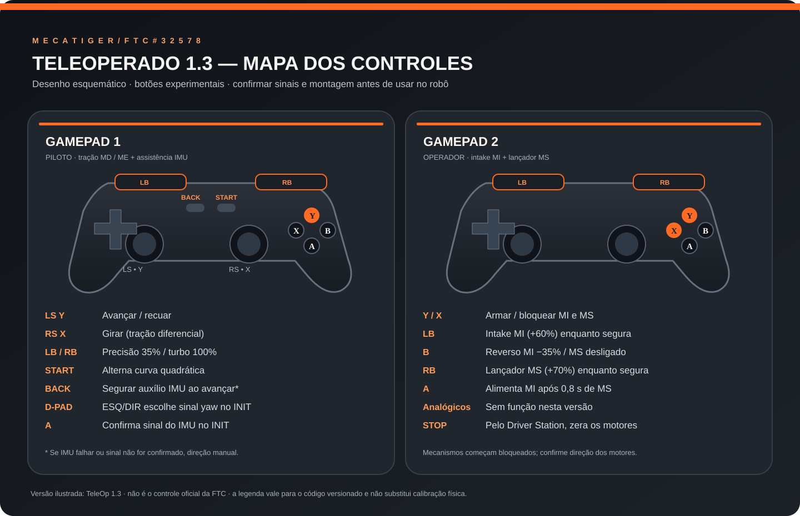

# Manual completo do TeleOp — Meca Tiger FTC #32578

**Temporada:** BIOBUZZ 2026–2027 · **Robot Controller:** FTC SDK 12.0 · **Linguagem:** Java



> Este desenho representa a **versão experimental TeleOp 1.3**, e não o mapeamento de um TeleOp já testado no robô. O layout dos botões do gamepad2 foi definido nesta etapa como proposta operacional. Nenhuma movimentação real ou lançamento foi efetuado pelo assistente. Antes de usar na competição, validar os sinais físicos, escolher os botões com os pilotos e registrar ensaios.

## 1. Qual versão escolher?

| Classe Java | No Driver Station | Recursos | Situação |
|---|---|---|---|
| [TeleOp10.java](../TeamCode/src/main/java/org/firstinspires/ftc/teamcode/teleOp/TeleOp10.java) | TeleOp 1.0 - Chassi | Chassi a 35%; sem IMU e sem mecanismos | Teste inicial de sinais |
| [TeleOp11.java](../TeamCode/src/main/java/org/firstinspires/ftc/teamcode/teleOp/TeleOp11.java) | TeleOp 1.1 - Manual Assistido | 35%/70%/100%; curva quadrática; rampas | Controle manual |
| [TeleOp12.java](../TeamCode/src/main/java/org/firstinspires/ftc/teamcode/teleOp/TeleOp12.java) | TeleOp 1.2 - IMU Experimental | 1.1 + manutenção de rumo BACK com proteção | **Experimental: sinal de yaw não aferido** |
| [TeleOp13.java](../TeamCode/src/main/java/org/firstinspires/ftc/teamcode/teleOp/TeleOp13.java) | TeleOp 1.3 - Completo Experimental | 1.2 + MI/MS em gamepad2 com trava | **Experimental: mecanismo físico não aferido** |

As quatro versões estão preservadas individualmente em [historico_teleop/](../historico_teleop/). Elas não substituem automaticamente a classe `robo` usada anteriormente no Android Studio: o fonte completo dessa classe **não foi recuperado** no GitHub.

## 2. Gamepad 1 — piloto

| Controle | Função quando o TeleOp está ativo | Observações |
|---|---|---|
| **Joystick esquerdo Y** | Avançar/recuar | Frente: joystick para cima (valor FTC Y negativo) |
| **Joystick direito X** | Girar diferencialmente | Sinal físico depende da montagem MD/ME |
| **LB** | Precisão a 35% | Prevalece sobre RB se os dois estiverem pressionados |
| **RB** | Turbo a 100% | Apenas em área apropriada |
| **Sem LB/RB** | Potência máxima normal de 70% | Válido na versão 1.1+ |
| **START** | Alterna curva quadrática com sinal | Começa **ativada**; um toggle por nova pressão |
| **BACK (segurado)** | Assistência de manutenção do heading pelo IMU | **Somente 1.2/1.3**; requer sinal escolhido e confirmado antes do START; funciona ao avançar/recuar e sem comando manual de giro |
| **D-pad ESQUERDA** | Durante INIT: escolhe sinal de yaw **−1** | Usar se joystick direito X positivo faz yaw **diminuir** |
| **D-pad DIREITA** | Durante INIT: escolhe sinal de yaw **+1** | Usar se joystick direito X positivo faz yaw **aumentar** |
| **A** | Durante INIT: confirma o sinal selecionado | Precisa ocorrer depois da seleção; segurar A enquanto muda a opção não confirma |
| **Demais controles** | Sem função nessas versões | Não atribuir uma ação antes de programá-la |

**Sem confirmação de sinal ou sem leitura válida do IMU, a assistência não entra em ação.** O piloto continua comandando MD/ME manualmente. Nunca escolher +1 ou −1 no acaso: isso exige verificação prévia do sentido físico.

### Assistência BACK: como realmente funciona

1. Antes da partida, usar a 1.0 para confirmar o sinal de rotação causado por joystick direito X positivo; no INIT da 1.2/1.3, escolher D-pad correspondente e pressionar A.
2. Com o robô em movimento para frente/trás, **segurar BACK**, mantendo o joystick direito centralizado; a referência angular é capturada **no momento de ativação**.
3. O controle injeta correção no **mesmo canal X do giro**, em vez de usar potência diferencial incompatível com a mistura MD/ME existente.
4. O piloto pode girar manualmente a qualquer momento: o comando do joystick direito prevalece; para manter o rumo novo, soltar e reativar BACK (ou recapturá-lo quando a assistê​​ncia recomeçar).
5. Se o erro exceder 12°, IMU ficar inválido, ou houver falha de leitura, o assistente desativa a correção; em caso de erro grande fica bloqueado até soltar BACK. O piloto continua responsável por STOP.

**Matemática empregada:** `erro = normalizar(rumoAlvo - yawAtual)`, `xCorrecao = clamp(sinalYaw * 0,012 * erro, -0,15, +0,15)`. A correção de potência passa pelas rampas normais. Não se trata de um PID completo: o **heading hold da 1.2/1.3 é P**, propositalmente conservador, e não o PID do autônomo.

## 3. Gamepad 2 — operador dos mecanismos (TeleOp 1.3)

O operador controla o **MI** (intake/alimentação) e o **MS** (lançador). Nada está ligado até o operador **armar** expressamente os mecanismos.

| Controle | Função | Proteção |
|---|---|---|
| **Y** (nova pressão) | **Arma MI/MS** | Só arma se LB, RB, A e B estiverem soltos; X não pode estar pressionado |
| **X** (segurado ou pressionado) | **Bloqueia MI/MS imediatamente** | Prioridade máxima; mantém desarmado até novo Y |
| **LB** (segurado) | MI no sentido de coleta, potência +0,60 | Apenas armado |
| **B** (segurado) | MI reverso, potência −0,35 | Prevalece sobre LB e A para desobstrução, apenas armado |
| **RB** (segurado) | MS ligado a +0,70 | Ao soltar, MS para e seu tempo de aquecimento é zerado |
| **A** (segurado) | MI alimenta a +0,60 | Só se RB mantém MS ligado **há 0,80 s** e mecanismos estão armados |
| **Joystick e gatilhos** | Não utilizados | Mantidos livres para expansões documentadas |

**Prioridade de MI:** desarmado/X → potência zero; B → reverso; A → alimentar **somente quando MS aqueceu**; LB → coleta; sem comando → MI zero.

**Importante:** 0,80 s é uma estimativa temporal, não um sensor de velocidade. O código **não mede RPM** de MS e **não conta peças disparadas**. Se o lançador não atingir velocidade útil em 0,80 s, o tempo precisa ser calibrado no robô ou substituído por feedback real em versão futura.

## 4. Chassi, matemática e suavização

As versões 1.0–1.3 mantêm a convenção solicitada:

```java
double MD = -gamepad1.right_stick_x - gamepad1.left_stick_y;
double ME = -gamepad1.right_stick_x + gamepad1.left_stick_y;
```

Depois da dead zone de 0,08, a 1.1+ pode aplicar `sign(x)*x²` e divide **as duas potências pelo mesmo máximo** `max(1, |MD|, |ME|)` para evitar distorção do comando combinado.

A rampa acelera em 2,0 unidades normalizadas/s e freia em 4,0 unidades/s, limitando cada `dt` a 0,10 s. Para inverter o sentido, a rampa passa por zero antes de acelerar no sentido oposto. **STOP desliga os motores imediatamente, sem rampa, no bloco finally.**

O código configura `MD.setDirection(REVERSE)` e `ME.setDirection(FORWARD)`; esses valores ainda **precisam combinar com a montagem física**, assim como a orientação `LogoFacingDirection.LEFT, UsbFacingDirection.UP` usada pelo IMU.

## 5. Sequência segura para liberar o TeleOp

1. Conferir `MD`, `ME`, `MI`, `MS` e `imu` na configuração ativa do Driver Station. Verificar rodas, fixações, cabos, bateria e STOP.
2. Usar [DiagnosticoSinais](../TeamCode/src/main/java/org/firstinspires/ftc/teamcode/Autonomo/DiagnosticoSinais.java) para medir yaw/ticks ao mover **manualmente** o chassi com motores desligados.
3. Executar a versão **1.0** em local isolado com potência máxima 0,35 para observar giro e translação. Anotar exatamente o sinal do yaw quando o piloto move X positivo.
4. Executar a **1.1**, começando por LB, verificar modo normal e turbo somente se houver espaço. Medir tempo de resposta, inversão segura, deriva e parada por STOP.
5. Somente então executar a **1.2**, selecionar e confirmar o sinal correto no INIT, testar BACK em trajetória curta e interromper se houver aumento de erro de heading.
6. Para a **1.3**, primeiro testar apenas o chassi sem armar o gamepad2. Depois testar X/Y e saída zero de MI/MS **sem peças e com montagem segura**. Finalmente calibrar intake e MS individualmente em área protegida.
7. Registrar cada ensaio com a [Ficha Geral](../MODELO_REGISTRO_ENSAIO_AUTONOMO.md), indicando commit, tensão da bateria, ângulos, distâncias, potências e resultado. Não considerar compilação/simulação como validação física.

## 6. Testes reproduzíveis e status

```bash
node tests/teleop_1x_logic.mjs
node tests/teleop_1x_static.mjs
node tests/teleop_12_13_logic.mjs
node tests/repositorio_integridade.mjs
```

O workflow [`.github/workflows/ftc-projeto.yml`](../.github/workflows/ftc-projeto.yml) executa testes Node e tenta compilar os autônomos e TeleOps conjuntamente contra o **FTC SDK 12.0**. Consultar o [Relatório de Integração](../docs/RELATORIO_REORGANIZACAO.md) para os resultados efetivamente confirmados, o SHA e eventuais falhas.

**Garantias que NÃO foram demonstradas:** direção física correta, IMU montado corretamente, PID calibrado, tempos de aquecimento do lançador corretos, transmissão, precisão de disparos, mecanismo sem travamentos e atuação do operador sob carga real.

## 7. Versões, histórico e próximos passos

| Versão | Mudança | Situação |
|---|---|---|
| 1.0 | Manual a 35% | Preservada |
| 1.1 | Curva, rampas, modos | Preservada |
| 1.2 | BACK com P de heading e seleção segura de polaridade do IMU | Experimental |
| 1.3 | Gamepad2 MI/MS, trava, aquecimento temporal e parada de todos os motores | Experimental |

As versões antigas não foram sobrescritas. O código original `robo` usado anteriormente na escola **não estava neste repositório**, então o mapeamento real de controles do robô só poderá ser declarado idêntico quando esse arquivo for recuperado e comparado.

**Fontes:** [FTC SDK 12.0 oficial](https://github.com/FIRST-Tech-Challenge/FtcRobotController/releases/tag/v12.0) e [documentação de programação FTC](https://ftc-docs.firstinspires.org/).
